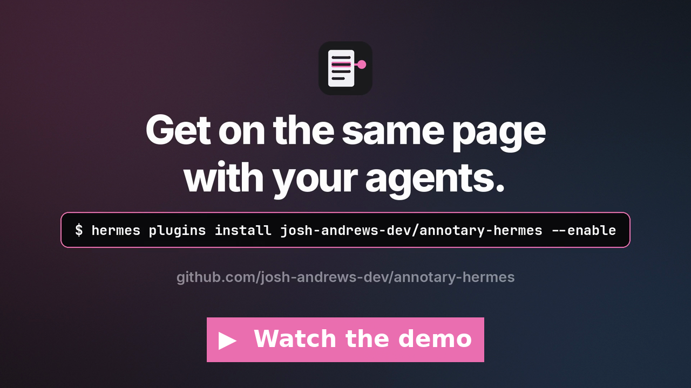
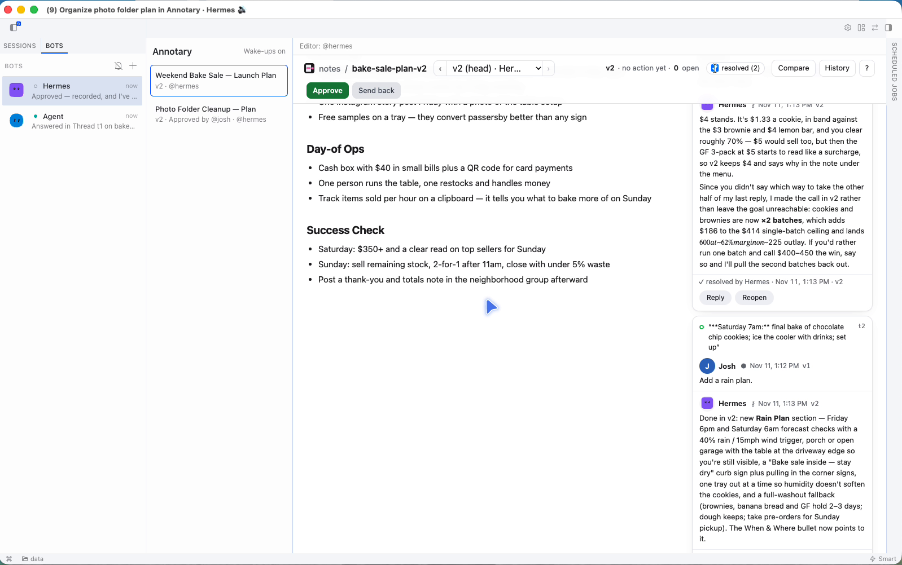
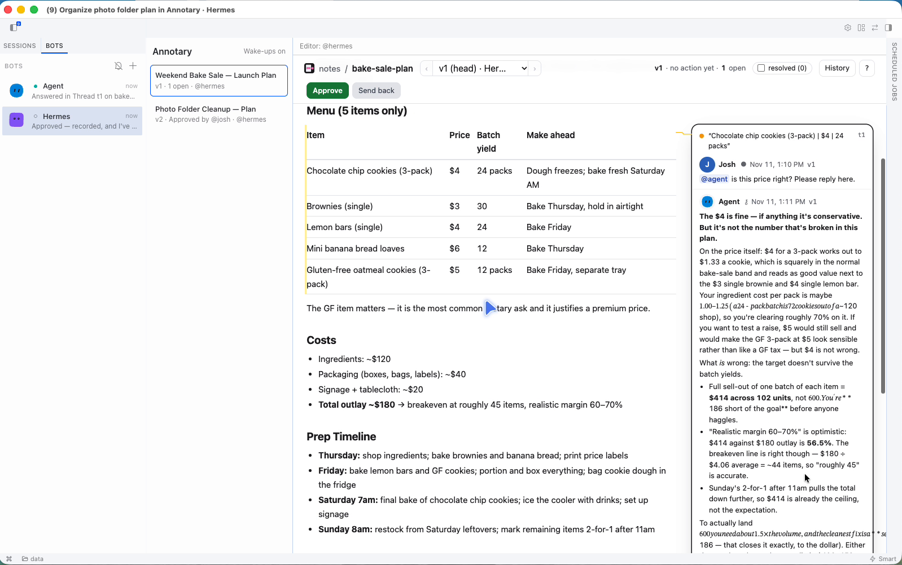
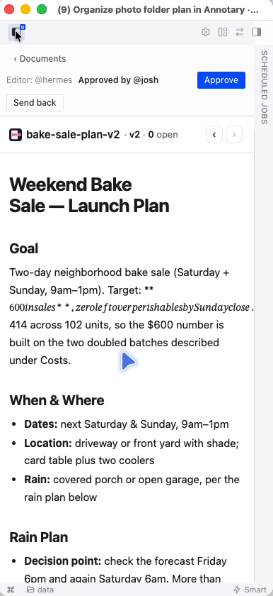

# Annotary for Hermes Agent

Part of [Annotary](https://github.com/josh-andrews-dev/annotary): it gives Hermes Agent its own private Annotary.

[](docs/media/annotary-hermes-demo.mp4)

*Demo, under 90 s: [docs/media/annotary-hermes-demo.mp4](docs/media/annotary-hermes-demo.mp4).*

<p>
  
  
</p>
<p></p>

Annotary for Hermes Agent: review your agents' plans and documents with comments, from Desktop,
the Webapp and your phone.

An agent shares a Markdown plan; you comment on exact lines in the **Annotary** page (Desktop's
sidebar, or the Webapp in any browser, phone included); you press **Send back** or **Approve**; the
agent wakes in the chat that shared it. After Send back it fixes what you asked, pushes one new
Version and answers each Thread; after Approve it answers what's waiting and does not push. Unlike Desktop's in-browser "Annotate" mode, which drops one note into the composer,
a Document keeps its Versions, Threads and replies.

## Install

Needs Hermes 0.23.0 or newer, on macOS or Linux (WSL counts as Linux).

### In the app (the Webapp, or Hermes Desktop on the same machine as Hermes)

1. **Capabilities → Plugins → Install from Git**, with `https://github.com/josh-andrews-dev/annotary-hermes`.
   Hermes marks it Unverified (it is not in the catalog yet); the dialog's "Install for profile"
   picks the profile (start with the default one).
2. **Every other profile** whose Bot should use Annotary: find the **Annotary** card (Filters →
   Installed, or search "annotary"; the catalog is listed first), open it, pick that profile in the
   card's profile menu, and choose **Install here**, then **Install**. After switching profiles,
   close the card and open it again: it can still show the last profile's state.
3. **Restart the gateway** (the status menu at the bottom left ("Backend ready") → Restart gateway), so the agents get the tools.
4. **The page.** In the browser you installed from, Hermes turns it on (the card's **Desktop** switch).
   In any other browser it starts off: turn on that switch once there. An Annotary link opened where
   it is off says so, with an **Open Plugins** button. Hermes Desktop turns it on by itself.
5. **Ask an agent to share something**, e.g. "write a short plan and share it with me in Annotary".
   Its first share starts with what is left to set up: your name (Annotary shows you as `@owner`
   on Hermes Cloud until you give it), wake-ups (so Send back, Approve and @mentions wake the Bot),
   and any profile without the plugin. Answer it in the chat.

A chat open while you turned the page on shows its Annotary card as plain text until you reload it.

**Using it.** Open a Document from the card's **Open** button or the link. To comment, select some
text: a **Comment** button appears. Type `@` to mention a Bot; with wake-ups on, it answers in that
Thread. **Send back** wakes the editor to fix what you asked and push a new Version; it resolves the
Threads it fixed, so on the new Version they are under the header's "resolved" filter (a Thread
whose text was rewritten sits at the bottom, under "orphaned"). **Approve** wakes the editor too,
to answer what is left; it pushes nothing. A Bot answers in the chat that shared the Document when
Hermes can still reach it, otherwise in its own chat. Its answer is in the Thread either way;
`hermes annotary status` lists each wake-up and whether it reached a chat.

### Hermes Desktop connected to a remote Hermes (Hermes Cloud, a VPS)

Hermes Desktop draws plugin pages only from the Mac (or PC) it runs on, never from the remote
Hermes. Installing from Desktop while it is connected covers both: the **Install from Git** dialog
always installs the agent half into the connected Hermes, for the profile you pick, and the page
into this machine's `desktop-plugins` folder. If you installed from the Webapp instead, run
**Install from Git** once from Desktop while connected, with **Force reinstall** on, to put the page
here. The agents, tools and Documents stay on the remote Hermes.

### From a terminal

```bash
hermes plugins install josh-andrews-dev/annotary-hermes --enable
hermes annotary enable --all        # tools in every profile
hermes gateway restart --detach
hermes annotary wake on             # optional: let Send back, Approve and @mentions wake the Bot
```

### Uninstall

1. **Stop the private server**: `hermes annotary stop` (or end the `annotary serve` on
   `127.0.0.1:7391`). Do this first: the command goes with the plugin.
2. **Capabilities → Plugins → Annotary → Uninstall**, for each profile that has it (pick the
   profile in the card's profile menu). Or in a terminal: `hermes plugins remove annotary`, and
   `hermes -p NAME plugins remove annotary` for each profile.
3. **Restart the gateway and the dashboard** before deleting anything: until they restart, the
   plugin's code is still loaded and starts its server again (on Hermes Cloud the dashboard restarts
   with `s6-svc -r /run/service/dashboard` in the instance's terminal).
4. **Your Documents stay** until you delete them. In the Hermes home (`~/.hermes`; `/opt/data` on
   Hermes Cloud): `annotary/` (the server, every Document, the owner's secrets),
   `desktop-plugins/annotary/`, `plugin-data/annotary/` (the default profile's Token), and
   `profiles/NAME/plugin-data/annotary/` for each other profile.

After that, a fresh install starts over: the next share asks your name again.

### Profiles you make later

Hermes loads a plugin into a profile only from that profile's own `plugins/` folder, and only
once its `config.yaml` enables it. So run `hermes annotary enable --all` again after making a
profile:

- **`hermes profile create NAME`** makes a profile with no Annotary: its agent has no Annotary
  tools or skill and does not know Annotary exists. `hermes -p NAME plugins enable annotary` alone
  fails ("No plugin named 'annotary'"), because the plugin is not in that profile's folder.
- **A clone of default** (`hermes profile create NAME --clone`, or a new Bot in Desktop's Bot
  Mode) has Annotary on, but as its own copy of the plugin, which plugin updates never reach.
  `enable --all` replaces that copy with a link to the installed plugin.

A profile you don't want to know about Annotary stays that way. After `hermes -p NAME plugins
disable annotary`, `enable --all` leaves it off, `doctor` and `members` don't complain about it,
and its Bot can't be made a Document's editor. `hermes annotary enable NAME` turns it back on.

The plugin says so: `hermes annotary members` and `hermes annotary doctor` mark each profile
where Annotary is off or runs its own copy, the reconcile reports it once, and a Document cannot be
handed to a Bot whose profile has Annotary off.

## What you get

- **One private Annotary server** for the whole Hermes install, on `127.0.0.1:7391` only.
- **An Annotary account (Member) per profile**, kept in step with your profiles: a new profile
  gets one within 5 minutes, a renamed one keeps its Member (through `previous_names`), a deleted
  one is disabled (its comments keep their author), and a profile made again under the same name
  gets the same Member back, enabled, with a new Token (the old one stays revoked). Each Bot's handle is its Bot Mode tag
  (`@coder`; the default profile is `@hermes` until you name it). You are the owner, named after
  your OS user; where that is a service account (Hermes Cloud runs as `hermes`), you are `@owner`
  until you give a name. The agent's first share asks for it, and `hermes annotary name "Your Name"`
  sets it too: while you have no name it also makes your handle (`@rowan`). `hermes annotary members` shows the mapping.
- **Each Bot's face next to its comments**: the Bot Mode face from Desktop, animated when Desktop
  animates it and still under reduced motion. A change to a Bot's face reaches Annotary within
  5 minutes.
- **Native tools** (no approval prompts, and they work in profiles with no terminal):
  `annotary_share`, `annotary_read`, `annotary_comment`, `annotary_threads`, `annotary_reply`, `annotary_push_version`,
  `annotary_handoff`, `annotary_act`, `annotary_list`, `annotary_set_name`, and a skill, `annotary`.
- **The Annotary page**: the Document list, then the Document itself: Annotary's own page in a
  sandboxed frame (Annotary's embed mode), fed through this plugin's backend, so it
  works on native Desktop, Desktop over SSH and the Webapp on a phone. Above it, the Document's
  editor and its last Action. **Send back** and **Approve** are always on screen: in the page's
  header when the page is wide enough, and in the bar above it when it is not. If the server cannot serve the frame (a development
  build without embed mode), the page shows the rendered Document, open Threads with reply and
  resolve, and a comment box instead. Chats on Desktop show
  an inline card for each shared Document.

## The review rule

The plugin, not the model, decides when an agent wakes:

- A plain comment wakes nobody: you can comment as long as you like.
- **Send back** or **Approve**, by you or by another Bot, wakes the Document's editor (the Bot
  that shared it) in the chat that shared it, with every open Thread. Never the editor's own.
- An **@mention** wakes only the Bot it names, to answer, never to edit.
- `annotary_push_version` refuses while a review is open, and refuses any Bot but the editor.
  `annotary_handoff` moves the editor.
- One agent waking another (an @mention or a Send back) happens at most 3 times per Document per
  hour.
- Bots can review each other: `annotary_read` a Document, `annotary_comment` on a passage,
  `annotary_act` to Send back. A plain comment still wakes nobody.

Waking needs Hermes's `allow_gateway_injection` permission for this plugin, per profile. It is
off until you turn it on (`hermes annotary wake on`, or Settings → Plugins); the agent's first share
asks whether you want it. While it is off, Send back, Approve and @mentions show as notifications, and the agent
sees them on its next Annotary tool call. A Bot that has no chat of its own on record (it never
used Annotary yet) is woken in its "Bot Chat", which Hermes creates if needed.

## What it writes, and where

Disclosed per the Hermes plugin catalog rules. Nothing leaves the machine except the one download.

| What | Where | Why |
|---|---|---|
| The `annotary` binary | `$HERMES_ROOT/annotary/bin/` | Downloaded once, at first use, from [Annotary's GitHub Release](https://github.com/josh-andrews-dev/annotary/releases), pinned by version and SHA-256 in [`annotary_hermes/install.py`](annotary_hermes/install.py) and checked before it is used. Never updated by itself: a new pin is a new plugin version. Each release tarball also carries a GitHub build attestation, so you can check where it was built: `gh attestation verify annotary-<target>.tar.gz --repo josh-andrews-dev/annotary`. |
| The server's data | `$HERMES_ROOT/annotary/data/` | Documents, Threads and Members. Never `~/.annotary`: a standalone Annotary keeps running beside it. |
| A background server | `annotary serve` on `127.0.0.1:7391` | Started when first needed and left running detached, so it outlives gateway restarts. Its update check is off. It and every `annotary` command get a minimal environment: `PATH`, `HOME`, `LANG`, `LC_*`, `TMPDIR`, `TZ` and its own `ANNOTARY_*` settings, never your API keys or other variables. A server an older version started with the whole environment is restarted. `hermes annotary stop` stops it. |
| Owner password and Token | `$HERMES_ROOT/annotary/secrets.json`, mode 600 | A long random password nobody types (it stops a browser on this machine signing in to the bare server by loopback trust); you reach Annotary only through Hermes's own sign-in. |
| One Token per profile | `<profile home>/plugin-data/annotary/token`, mode 600 | What that profile's tools act as. Never on a command line or in a log. |
| Shared state | `$HERMES_ROOT/annotary/state.json` | Which Member each profile is, each Document's editor and sharing session. No secrets. |
| Each Bot's face | The private server (from `profile.yaml` and `assets/avatar.*`) | Read from the profile and uploaded to the loopback server with that Bot's own Token, only when it changes. A photo is sent as it is. |
| The page | `$HERMES_ROOT/desktop-plugins/annotary/` | The package's desktop half (`desktop/plugin.js`), copied there by Hermes itself, as for any plugin with a page. |
| Plugin links | `<profile home>/plugins/annotary` → the installed plugin | Only from `hermes annotary enable --all` or `enable <profile>`, which then run `hermes -p <profile> plugins enable annotary` (`--all` skips a profile where you turned the plugin off). Where a cloned profile holds its own copy of this plugin (its `plugin.yaml` names `annotary` and it has the `annotary_hermes` package), that copy is removed and replaced by the link; any other folder there is left alone. |
| A Bot Chat turn | `hermes -p <profile> chat --in <your home folder> -c "Bot Chat" --create-if-missing -Q --query-file …`, run by the gateway in your home folder; the query file sits in `$HERMES_ROOT/annotary/wakes/` while it runs | Only to wake a Bot that has no chat of its own on record, and only with that profile's wake-ups on. One turn per Bot at a time. It is a single-query session, so a dangerous command follows your `approvals.single_query_mode` (default `deny`); a new Bot Chat never inherits the gateway's YOLO mode, other launch flags (rules, hooks, safe mode, user config), behavior variables (system prompt, prefill, provider, project plugins) or session approval context. A Bot Chat that an earlier version of this plugin made keeps the flags the gateway had then: type `/yolo` in it to turn YOLO off, or delete that chat so the next wake-up makes a new one. |
| Wake-up consent | Read with `hermes -p <profile> config get --json plugins.entries.annotary.allow_gateway_injection` | Before each wake-up, to check that profile's wake-ups are on. Only a JSON `true` counts; an error, a missing key or no answer within 20 seconds means off. Nothing is written. |
| Your Webapp settings | Read from `config.yaml` (`webapp.enabled`, `webapp.public_url`) | Read only, through Hermes's own reader where it can, to build each Document's web link. Nothing is written there; `hermes annotary doctor` only prints the block to add. |

**Turning the page on in a browser.** Hermes starts a plugin's page switched off in each new
browser, so in the Webapp turn on **Annotary** once in Capabilities → Plugins. Native Desktop turns
it on when the plugin is installed. An Annotary link opened in a browser where the page is off shows
a notice with an **Open Plugins** button, and the Document opens once you turn it on; on a phone
too. Until then the chat cards, which the page draws, show as plain text. The agent's first share
tells you to do this until the page has loaded somewhere, and `hermes annotary doctor` says whether
it has.

**Updating the plugin.** Annotary's card has no Update button. Run **Install from Git** again with
the same URL and **Force reinstall** on, once for each profile that has it (pick it in "Install
for profile"). The toolbar's **Update all** works too, but updates every plugin. In a terminal:
`hermes plugins install josh-andrews-dev/annotary-hermes --force`, with `-p NAME` for each other
profile.

**After updating the plugin**, restart the gateway (for the tools) and the dashboard (for the page's backend):
Hermes reloads neither for a plugin it has already loaded. On Hermes Cloud the dashboard runs under s6, so from the
instance's terminal: `s6-svc -r /run/service/dashboard`. Run from a chat, this ends that chat's turn
("Response stopped"), and Desktop shows "Backend offline" for a few seconds: that is the restart,
not a failure.

An earlier version of this plugin copied its page in by hand with no package marker; its setup step
now removes that copy, so Hermes can put the plugin's own page in its place.

## Commands

| Command | What it does |
|---|---|
| `hermes annotary setup` | Install the binary, start the server, sync Members |
| `hermes annotary status` | Server, page, Members and recent wake-ups, as JSON |
| `hermes annotary members` | Which Member each profile is |
| `hermes annotary enable --all` | Tools on in every profile you have not turned off (a profile made later needs it again) |
| `hermes annotary enable PROFILE` | Tools on in one profile, including one where you turned them off |
| `hermes annotary wake on\|off` | Let Send back, Approve and @mentions wake the chat |
| `hermes annotary doctor` | Check and repair; prints the `webapp:` settings for a VPS or Docker |
| `hermes annotary stop` / `logs` | Stop the server / its log |

On a VPS, in Docker or on Hermes Cloud, where Desktop's Web Access switch cannot be used, turn the
Webapp on in `config.yaml` (`webapp.enabled`, `webapp.public_url`, a sign-in provider);
`hermes annotary doctor` prints the exact block.

With `webapp.public_url` set, each share returns a full link to the Document,
`<public_url>/?annotary=<id>`. The page opens that Document once it loads, also after a sign-in
(Hermes Cloud's, or the Webapp's own), which keeps the address's query. Without `public_url` there is no web link, and the agent says so.

A sign-in link signs in only the tab that opened it, because Hermes keeps the grant in that tab's
`sessionStorage`. So on a Webapp with only sign-in links, an Annotary link opened in a new tab lands
on Hermes's sign-in screen.

## Development

`make help` lists the commands; `make lint test` before a pull request. The tests run a real
`annotary serve` (the pinned release, downloaded once into `~/.cache/annotary-hermes-tests`).
`ANNOTARY_HERMES_DEV_BINARY=/path/to/annotary` runs an unreleased Annotary build instead (every
Hermes process needs it: the gateway does not inherit your shell, so put it in Hermes's `.env`
while you test, and restart the gateway after taking it out, since a running gateway keeps it and
starts the server on that build again), `ANNOTARY_HERMES_PORT` moves the server, and `ANNOTARY_HERMES_DOWNLOAD_CACHE`
keeps checked release tarballs between runs; all three are for development only. Without the
first, a server found running any binary but the pinned one, read from the server process itself
so a dev build that reports the pinned version counts too, is stopped and restarted on the pinned
one on the next call (also after a plugin upgrade that moves the pin). To switch at once after
taking the override out, run `hermes annotary stop`. `make validate` runs Hermes's plugin
validator where Hermes is installed.

A development build newer than the pinned binary migrates the server's store, and the pinned binary then refuses to open it. Copy `$HERMES_ROOT/annotary` before pointing a real install at one, and put the copy back afterward.

## Contributing

Bug reports and feature requests go to [Issues](https://github.com/josh-andrews-dev/annotary-hermes/issues),
questions to [Discussions](https://github.com/josh-andrews-dev/annotary-hermes/discussions). See
[CONTRIBUTING.md](CONTRIBUTING.md), and [SECURITY.md](SECURITY.md) for security reports.

## License

The Bot face code carries MIT-licensed ports of Hermes Desktop's faces and of blobatar: see
[docs/THIRD_PARTY.md](docs/THIRD_PARTY.md).

Licensed under either of [Apache License, Version 2.0](LICENSE-APACHE) or [MIT license](LICENSE-MIT)
at your option.

Unless you explicitly state otherwise, any contribution intentionally submitted for inclusion in
this project by you, as defined in the Apache-2.0 license, shall be dual licensed as above,
without any additional terms or conditions.
